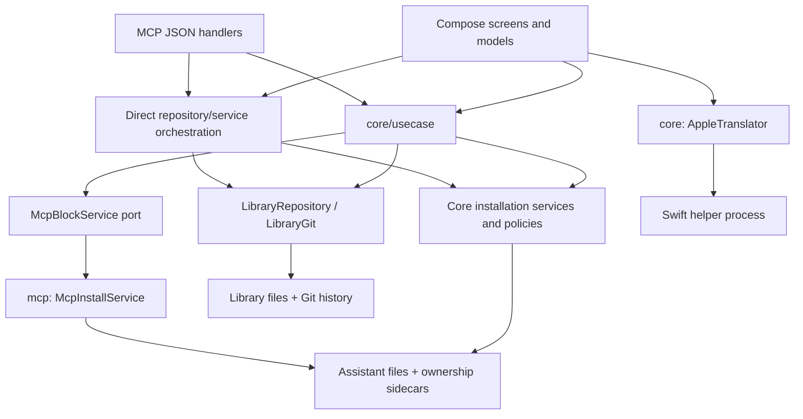

# Ruleblend architecture audit

Date: 2026-10-17. Source baseline: `376edebddef66cbee6fa9e6009443c0698e9aa95`.

Source-based assessment and prioritized recommendation register. Recommendations become adopted
work through the project's decision and planning process. Findings describe the inspected baseline;
implementation work should recheck them against the current source. Concurrent, unrelated Library UI edits are outside this
assessment. Native UI acceptance, the real Apple Translation helper and Windows execution were
outside the audit's runtime checks.

## Assessment

The three-module desktop architecture is appropriate. Dependency direction is respected, portable
parsing is separated from JVM integration, and common installation policies already prevent a large
class of inconsistencies between GUI and MCP.

The principal weakness is the gap between **atomic file replacement**, **serialized writers** and
**a complete application operation**. The first two are implemented extensively. They do not by
themselves protect an old editor draft, a compensating rollback, a rule whose scope failed to save,
or a reader assembling several files. These gaps deserve attention before structural refactoring.

### Structure and responsibilities

| Area | Actual responsibility | Architectural boundary |
|---|---|---|
| `core/commonMain` | Library models, managed-region formats, parsing and text transformations | Portable logic without Compose or MCP SDK |
| `core/jvmMain` | Application use cases, filesystem persistence, JGit history/sync, assistant adapters, installations and translation transport | Business decisions and machine integration share one Gradle module |
| `mcp/jvmMain` | Stdio server, JSON tool facade, assistant MCP configuration writers, bundled integration | Implements the core MCP installation port; also contains runtime assembly |
| `app/jvmMain` | Compose UI, screen models, navigation, OS actions and Swing/PTY assistance | Also retains some business workflows and assembles its own service graph |
| `tools/` and CI | Import/process fixtures, contracts, packaging, licensing and UI acceptance runners | Native acceptance is separate from the ordinary test gate |
| `tools/translate-helper/` | Swift bridge to Apple Translation | Long-lived subprocess using an NDJSON protocol |

Storage is split between the portable Git-backed library and machine-local configuration,
ownership state and caches under `~/.ruleblend/`. GUI and MCP share an advisory process lock.
Target writes also compare the file identity before replacement. Imported previews retain reviewed
content rather than refetching it at apply time. These are sound foundations.

Sources: [module declarations](../settings.gradle.kts),
[core dependencies](../core/build.gradle.kts), [MCP dependencies](../mcp/build.gradle.kts),
[app dependencies](../app/build.gradle.kts#L359),
[application use cases](../core/src/jvmMain/kotlin/dev/ruleblend/core/usecase/),
[target mutation coordinator](../core/src/jvmMain/kotlin/dev/ruleblend/core/storage/TargetMutationCoordinator.kt).

## Prioritized recommendations

P1: loss of edits, an incorrect scope, or an operation without an effective completion bound.
P2: reliability, consistency and extension risks.
P3: maintainability improvements after the failure contracts are secured.

“Defect” identifies an existing executable path. “Risk” identifies an unsupported guarantee or
missing boundary; it does not assert that a production incident occurred.

| Order | Priority | Finding | Recommendation |
|---|---|---|---|
| A01 | P1 | Rollback can overwrite a later external edit | Guard compensation against the bytes written by this operation |
| A02 | P1 | Old library drafts overwrite newer or deleted objects | Add revision-aware update and separate create/update contracts |
| A03 | P1 | A failed scope write exposes a committed rule as global | Make rule content and local scope one recoverable operation |
| A04 | P1 | Translation timeout cannot stop blocking process I/O | Give subprocess exchange a real deadline and bounded shutdown |
| A05 | P2 | Multi-file library reads can mix revisions | Introduce one coherent library snapshot boundary |
| A06 | P2 | Read failures look like absence; one corrupt object blocks a catalog | Return explicit read errors and isolate invalid objects |
| A07 | P2 | UI event handlers perform synchronous disk/Git work | Move all persistent operations behind asynchronous model commands |
| A08 | P2 | Business workflows remain in GUI and MCP facades | Finish consolidating application commands in core |
| A09 | P2 | Some long operations hold the global mutation lock | Stage remote/archive work outside short, bounded critical sections |
| A10 | P2 | ZIP import has no archive-wide resource budget | Bound total decompressed bytes, entries and retained previews |
| A11 | P2 | Older builds discard unknown configuration fields | Introduce format evolution and safe downgrade handling |
| A12 | P2 | Runtime assembly is duplicated and safety dependencies are optional | Share explicit production wiring with a mandatory mutation context |
| A13 | P2 | Native runtime acceptance is outside the standard CI gate | Gate releases on bounded offline native smoke checks |
| A14 | P3 | Persistence, merge policy and facade responsibilities are concentrated | Extract narrow components and enforce package boundaries |

### A01 — Protect rollback from external edits

**Defect.** Forward writes compare file identities, but compensation restores the original snapshot
without checking that the current file still contains this operation's output. If another file
fails after an external editor saved the first file, rollback replaces that newer edit. The result
can still report `ROLLED_BACK`. Whole-file and directory rollback helpers have the same assumption.

Sources: [target rollback](../core/src/jvmMain/kotlin/dev/ruleblend/core/integration/IntegrationService.kt#L342),
[file rollback helper](../core/src/jvmMain/kotlin/dev/ruleblend/core/integration/TargetWrite.kt#L79),
[directory restore](../core/src/jvmMain/kotlin/dev/ruleblend/core/storage/DirectoryReplace.kt#L98),
[MCP compensation](../mcp/src/jvmMain/kotlin/dev/ruleblend/mcp/install/McpInstallService.kt#L264).

**Change.** Record both the previous state and each successfully written state. Undo only while
the file/tree matches the latter, including when undo would delete a newly created path. Preserve
conflicting edits and recovery material, and return an explicit unresolved-compensation outcome.

**Completion criterion.** A later write failure cannot overwrite or delete an external edit made
after an earlier successful write. The same contract covers rules, MCP configs and installed trees.

### A02 — Detect stale editor saves

**Defect.** `saveBlock` reloads the current object but uses it only to calculate the next version.
It never checks that the submitted draft was based on that object. A GUI draft can therefore
replace an MCP edit, or recreate an object another process deleted. Group/profile save operations
have the same whole-object replacement contract. Git history makes recovery possible, but saving
does not reveal the conflict.

Sources: [block save](../core/src/jvmMain/kotlin/dev/ruleblend/core/storage/LibraryRepository.kt#L100),
[group save](../core/src/jvmMain/kotlin/dev/ruleblend/core/storage/LibraryRepository.kt#L194),
[GUI draft save](../app/src/jvmMain/kotlin/dev/ruleblend/app/library/LibraryModel.kt#L702).

**Change.** Carry an expected revision from read to update and compare it under the shared lock.
Use a fingerprint covering metadata and content: the displayed version does not advance for every
metadata change. Separate creation, updating and explicitly confirmed replacement. Return a typed
conflict that preserves the draft and offers comparison with the current object.

**Completion criterion.** Concurrent edits and edit-versus-delete produce a conflict, without
silently replacing or recreating the object.

### A03 — Keep rule scope attached to its mutation

**Defect.** A rule is committed before its project scope is saved into `config.json`. If that
second write fails, the command throws while the rule remains in the library. Absence from
`ruleScopes` means global scope. Multi-object deletion and membership changes can likewise stop
after some commits; `LibraryChange` represents only success and cannot describe the partial state.

Sources: [scope semantics](../core/src/jvmMain/kotlin/dev/ruleblend/core/usecase/MutateLibrary.kt#L26),
[create/save ordering](../core/src/jvmMain/kotlin/dev/ruleblend/core/usecase/MutateLibrary.kt#L61),
[delete ordering](../core/src/jvmMain/kotlin/dev/ruleblend/core/usecase/MutateLibrary.kt#L133),
[MCP rule update](../mcp/src/jvmMain/kotlin/dev/ruleblend/mcp/RuleblendTools.kt#L497).

**Change.** Define the recoverable unit around content, scope and required memberships. Persist
intent before exposing a new scoped object, then complete or compensate it. A rule with pending or
unreadable scope must be ineligible for installation. For operations where partial completion is
intentional, return committed, failed and pending parts explicitly.

**Completion criterion.** Failure or interruption between content and scope persistence never
widens a project's rule to global scope; reopening can complete or safely undo the operation.

### A04 — Make translation deadlines effective

**Defect.** `withTimeoutOrNull` surrounds `withContext(Dispatchers.IO)`, but `send` blocks in
`BufferedReader.readLine()`. Coroutine cancellation does not finish that call. Recovery after the
timeout is reached only when the blocking call returns. `reset` also closes the reader before
killing the process; a reader close can wait on the lock held by an active read.

Sources: [translation exchange](../core/src/jvmMain/kotlin/dev/ruleblend/core/translate/AppleTranslator.kt#L89),
[process I/O and reset](../core/src/jvmMain/kotlin/dev/ruleblend/core/translate/TranslateChannel.kt#L47),
[current timeout test](../core/src/jvmTest/kotlin/dev/ruleblend/core/translate/AppleTranslatorWireTest.kt#L143).

**Change.** Use a supervised process channel with bounded response delivery and a cancellation path
that terminates the child and unblocks pipe readers. Bound cleanup as well as request waiting;
preserve cancellation rather than converting it into an ordinary retryable failure.

**Completion criterion.** A helper that leaves stdout open without answering is terminated within
the configured deadline plus a documented cleanup allowance. A subsequent request can start a peer.
A deadline test must bound elapsed time, not merely inspect the eventual exception.

### A05 — Read coherent library snapshots

**Risk.** `snapshot()` reads collections sequentially without holding the library lock.
`loadSkillSnapshot` reads metadata, the main document and the file tree separately while replacement
updates that tree in place. A reader may assemble objects from different generations or encounter a
file removed mid-read. `FileReadScope` memoizes individual reads; it is not a multi-file snapshot.
Mod reads already take the library lock, so the read contract differs by object kind.

Sources: [snapshot construction](../core/src/jvmMain/kotlin/dev/ruleblend/core/usecase/LibraryRead.kt#L11),
[skill snapshot](../core/src/jvmMain/kotlin/dev/ruleblend/core/storage/LibraryRepository.kt#L295),
[mod reads](../core/src/jvmMain/kotlin/dev/ruleblend/core/storage/LibraryRepository.kt#L427),
[scan cache](../core/src/jvmMain/kotlin/dev/ruleblend/core/storage/FileReadScope.kt#L30).

**Change.** Provide a single library read boundary that captures a coherent immutable snapshot
under a short shared lock, or uses an explicitly validated mutation-generation protocol. Pass that
snapshot into scans and presentation instead of repeatedly loading objects during one operation.

**Completion criterion.** Concurrent skill replacement and library membership changes cannot
produce a successful snapshot combining incompatible generations.

### A06 — Distinguish missing, unreadable and invalid data

**Defect.** `FileReadScope` collapses every read exception into `null`, and target scanning maps
that to `exists = false`. MCP entry discovery also turns parser failures into empty entry lists.
Conversely, a single malformed block/group can fail an entire repository list. The UI therefore
cannot reliably distinguish an empty place, an inaccessible file and a partly damaged library.

Sources: [file reads](../core/src/jvmMain/kotlin/dev/ruleblend/core/storage/FileReadScope.kt#L71),
[target scanning](../core/src/jvmMain/kotlin/dev/ruleblend/core/integration/IntegrationService.kt#L245),
[catalog parsing](../core/src/jvmMain/kotlin/dev/ruleblend/core/storage/LibraryRepository.kt#L87),
[MCP entry discovery](../mcp/src/jvmMain/kotlin/dev/ruleblend/mcp/install/McpInstallService.kt#L48),
[config quarantine](../core/src/jvmMain/kotlin/dev/ruleblend/core/config/AppConfig.kt#L316).

**Change.** Return typed states such as missing, readable, invalid and inaccessible, with the path
and cause. Catalog reads should expose valid objects alongside diagnostics; operations depending on
invalid objects must remain blocked. Never treat an unparsed object as permission to delete its
memberships. Quarantine must recheck the inspected bytes under the shared lock before moving a file.

**Completion criterion.** A damaged object leaves unrelated objects inspectable. Unreadable target
or ownership data is shown as unknown/error and cannot authorize a destructive write.

### A07 — Remove synchronous persistence from UI handlers

**Defect in scheduling; responsiveness risk.** Several Library commands call synchronous
`MutateLibrary` and JGit work through a non-suspending `guard`. Settings and column-width handlers
also write configuration directly. These callbacks can wait on filesystem work or another process
while running on the Compose event thread. Existing asynchronous save/load paths demonstrate that
the project already supports the required separation.

Sources: [Library commands](../app/src/jvmMain/kotlin/dev/ruleblend/app/library/LibraryModel.kt#L666),
[synchronous guard](../app/src/jvmMain/kotlin/dev/ruleblend/app/library/LibraryModel.kt#L933),
[column persistence](../app/src/jvmMain/kotlin/dev/ruleblend/app/library/LibraryModel.kt#L648),
[settings persistence](../app/src/jvmMain/kotlin/dev/ruleblend/app/settings/SettingsModel.kt#L441).

**Change.** Run persistent commands on an injected worker dispatcher and publish immutable results
on the UI thread. Serialize related mutations, expose progress/cancellation and coalesce frequent
layout/text-setting writes. Keep state publication outside worker execution.

**Completion criterion.** A blocked repository or process lock does not prevent typing, navigation
or repainting. Repeated commands have an explicit queue or rejection policy.

### A08 — Complete the application-use-case boundary

**Defect-prone architectural gap.** Adoption allocates IDs and saves rules directly inside
`IntegrationModel`; its initial ID list is read before later per-object write locks. Another
writer can take an ID in between. Resolve also coordinates saving library versions and rewriting
targets in the app module. MCP rule updates separately orchestrate content and scope. These paths
carry business rules outside the use-case layer described in the architecture.

Sources: [batch adoption](../app/src/jvmMain/kotlin/dev/ruleblend/app/integration/IntegrationModel.kt#L1341),
[Resolve orchestration](../app/src/jvmMain/kotlin/dev/ruleblend/app/resolve/ResolvePlaceService.kt#L62),
[MCP update orchestration](../mcp/src/jvmMain/kotlin/dev/ruleblend/mcp/RuleblendTools.kt#L497),
[existing shared mutations](../core/src/jvmMain/kotlin/dev/ruleblend/core/usecase/MutateLibrary.kt#L51).

**Change.** Move adoption, conflict resolution and complete rule updates into typed core commands.
Allocate IDs, validate preconditions and apply scope/membership policy inside their mutation
boundary. GUI and MCP should translate input and render the same command results.

**Completion criterion.** The same command and initial state produce the same policy decisions
through either facade. Concurrent create/adopt cannot overwrite an unrelated new object.

### A09 — Shorten and bound mutation locks

**Risk.** Ordinary fetch/push intentionally run outside the library write lock. Initial remote
bootstrap and whole-library replacement still clone while holding it. Credential lookup can wait
much longer than the process lock timeout. MCP archive preview also parses the ZIP under the
repository lock. Additionally, the outer in-process `ReentrantLock.withLock` has no timeout;
waiting for it is not covered by the advertised process-lock bound.

Sources: [lock nesting](../core/src/jvmMain/kotlin/dev/ruleblend/core/storage/LibraryGit.kt#L107),
[remote replacement](../core/src/jvmMain/kotlin/dev/ruleblend/core/storage/LibraryGit.kt#L387),
[bootstrap and clone](../core/src/jvmMain/kotlin/dev/ruleblend/core/storage/LibraryGit.kt#L538),
[credential timeout](../core/src/jvmMain/kotlin/dev/ruleblend/core/storage/SystemGitCredentialsProvider.kt#L25),
[archive preview lock](../mcp/src/jvmMain/kotlin/dev/ruleblend/mcp/LibraryExchangeTools.kt#L46).

**Change.** Fetch/clone/parse into private staging outside the mutation lock. Acquire the shared
lock only to revalidate the library/config revision and publish or merge. Document one acquisition
order, bound every wait and make cancellation observable while queued.

**Completion criterion.** Slow authentication, an unavailable remote or ZIP parsing does not hold
the lock needed by unrelated local configuration and target writes.

### A10 — Bound complete archives and preview retention

**Risk.** ZIP import limits each decompressed entry and each individual package tree, but not the
aggregate number of entries, library objects or decompressed bytes across an archive. Parsed
contents remain in memory. Limiting MCP previews to two entries does not bound their byte size.
Memory exhaustion is a risk inferred from allocation paths, not an observed incident.

Sources: [archive accumulation](../core/src/jvmMain/kotlin/dev/ruleblend/core/exchange/LibraryArchive.kt#L145),
[per-entry bound](../core/src/jvmMain/kotlin/dev/ruleblend/core/exchange/LibraryArchive.kt#L314),
[preview retention](../mcp/src/jvmMain/kotlin/dev/ruleblend/mcp/LibraryExchangeTools.kt#L46),
[Git import limits](../core/src/jvmMain/kotlin/dev/ruleblend/core/storage/GitImportCheckout.kt#L10).

**Change.** Share an import budget covering total entries, objects, decompressed bytes and retained
preview bytes. Charge it during streaming before allocation; include skipped/unknown entries.
Limit simultaneous preview construction as well as the completed preview cache.

**Completion criterion.** Many individually valid small entries or packages are rejected at a
deterministic aggregate limit without exhausting the GUI/MCP process.

### A11 — Make configuration evolution lossless

**Defect in downgrade compatibility.** Configuration accepts unknown keys and enum values, but a
subsequent update serializes only the fields this build knows. A build can read a newer config and
then erase its unknown settings while saving an unrelated preference. There is no configuration
format version or migration gate. The existing path-migration backup covers a different case.

Sources: [configuration codec](../core/src/jvmMain/kotlin/dev/ruleblend/core/config/AppConfig.kt#L297),
[replacement and update](../core/src/jvmMain/kotlin/dev/ruleblend/core/config/AppConfig.kt#L356).

**Change.** Add explicit format evolution and migration rules. Preserve unknown data when safely
updating a compatible document, or open a newer unsupported format without write access.
Handle coerced known fields deliberately instead of silently persisting defaults over newer values.

**Completion criterion.** An older build changing a window or theme preference cannot erase fields
introduced by a newer build. Unsupported migrations preserve the original bytes.

### A12 — Centralize safe production assembly

**Risk.** GUI and MCP independently construct repositories, agent lists, installers, sidecars and
services. Several constructors default to a coordinator or repository with no process lock.
Both inspected production graphs supply the shared lock to the main installation services, but
safety remains a caller convention. `BackupService` separately assumes GUI-only access is sufficient
even though it restores files that MCP can also mutate.

Sources: [GUI assembly](../app/src/jvmMain/kotlin/dev/ruleblend/app/Main.kt#L371),
[MCP assembly](../mcp/src/jvmMain/kotlin/dev/ruleblend/mcp/RuleblendServer.kt#L82),
[optional coordination](../core/src/jvmMain/kotlin/dev/ruleblend/core/storage/TargetMutationCoordinator.kt#L25),
[repository defaults](../core/src/jvmMain/kotlin/dev/ruleblend/core/storage/LibraryRepository.kt#L62),
[backup/restore boundary](../core/src/jvmMain/kotlin/dev/ruleblend/core/storage/BackupService.kt#L17).

**Change.** Build one non-Compose runtime factory with explicit home/library paths, agent registry,
shared mutation context and lifecycle ownership. Require that context for production writers;
make unlocked test construction an explicit alternative. Coordinate manual restore and its derived
state through the same boundary.

**Completion criterion.** Adding an assistant or state store updates one production registry.
Every writer of shared files uses the corresponding mutation context, including manual restore
and a newly introduced facade.

### A13 — Gate shipped native boundaries

**Assurance gap.** CI runs the three modules' tests and compiles the opt-in root UI suite; that is
different from executing it. CI also exercises the packaged Windows MCP launcher. Swing/JediTerm/PTY
startup, native input and shutdown, real helper pipe behavior and platform-specific launch paths need
acceptance beyond Compose/model tests. The
docflow backlog already records outstanding native platform work.

Sources: [CI gate](../.github/workflows/ci.yml#L74),
[separate UI compilation](../app/build.gradle.kts#L286),
[PTY lifecycle](../app/src/jvmMain/kotlin/dev/ruleblend/app/assistance/PtyAssistanceTerminal.kt#L28),
[current acceptance backlog](docflow.md#L17).

**Change.** Reuse the existing offline fixtures for bounded packaged-app smoke checks on the
supported macOS and Windows architectures. Cover startup, Unicode/space paths, cancellation,
process-tree cleanup and shutdown. Keep acceptance that requires an installed language pack in a
separate explicit release gate with visible prerequisites.

**Completion criterion.** Shipping a native runtime change requires a recorded pass on its target
platform; compiling a runner or skipping a missing prerequisite cannot count as that pass.

### A14 — Extract responsibility boundaries after securing behavior

**Maintainability risk.** `LibraryGit` combines local history, remote scheduling, transport,
credentials, checkout replacement and object-specific merge policy. `RuleblendTools` combines
protocol validation, domain orchestration and rendering. Internally, storage imports integration
format/constants while integration depends on storage. Gradle's acyclic module graph does not
enforce these package-level boundaries.

Sources: [Git service](../core/src/jvmMain/kotlin/dev/ruleblend/core/storage/LibraryGit.kt),
[MCP facade](../mcp/src/jvmMain/kotlin/dev/ruleblend/mcp/RuleblendTools.kt),
[storage-to-format dependency](../core/src/jvmMain/kotlin/dev/ruleblend/core/storage/GitSubagentDiscovery.kt#L7),
[storage-to-marker dependency](../core/src/jvmMain/kotlin/dev/ruleblend/core/storage/LibraryObjectId.kt#L3).

**Change.** Extract local journal/history, remote transport/scheduling and merge policy as narrow
components. Separate MCP decoding/rendering from application commands. Move shared identities and
formats below both storage and integration. Add lightweight dependency rules so UI cannot acquire
new repository mutation paths accidentally.

**Completion criterion.** A merge-policy change can be checked without constructing UI or MCP,
and dependency checks reject new reverse dependencies or facade-owned domain mutations.

## Recommended implementation sequence

1. Secure compensation, revision checks and scope persistence (A01–A03).
2. Fix subprocess deadlines independently (A04).
3. Establish snapshot and read-error contracts, then move all UI persistence off the event thread
   (A05–A07).
4. Consolidate application commands and production wiring; this gives later changes one policy and
   mutation boundary (A08, A12).
5. Shorten critical sections, bound imports and formalize config evolution (A09–A11).
6. Establish native release gates before shipping affected runtime changes (A13).
7. Extract concentrated components behind the stabilized contracts (A14).

Each implementation should add failure-path coverage for its completion criterion. Existing
ownership protections, atomic replacement, reviewed import snapshots and module direction should
remain the foundations. Work status and scheduling belong in docflow when these recommendations
are selected for implementation.
